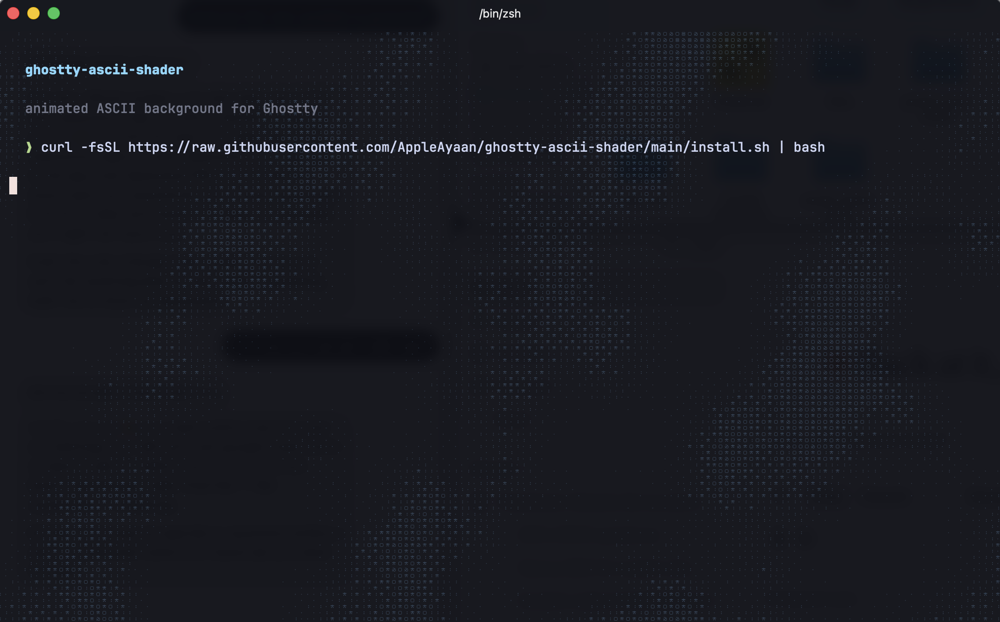

# Ghostty ASCII Background



An animated background for the [Ghostty](https://ghostty.org) terminal. Small ASCII characters (`. : * o & 8 @`) drift slowly behind your text like clouds. They're drawn only on empty background, so your text stays readable.

It's a single GLSL shader file that Ghostty runs on top of the terminal. You don't need any plugins or extra apps.

---

## Quick install (one command)

1. Install Ghostty from **https://ghostty.org/download** if you don't have it.
2. Open Ghostty and paste:

   ```bash
   curl -fsSL https://raw.githubusercontent.com/AppleAyaan/ghostty-ascii-shader/main/install.sh | bash
   ```

3. Press **Cmd + Shift + ,** (macOS) or **Ctrl + Shift + ,** (Linux) to reload the config, or quit and reopen Ghostty.

The script:
- downloads the shader to `~/.config/ghostty/shaders/`
- backs up your Ghostty config before changing it
- comments out any `custom-shader` lines you already have
- adds the new lines at the end of the config

---

## Manual install (step by step)

If you'd rather not run a script:

**1. Download the shader**

```bash
mkdir -p ~/.config/ghostty/shaders
curl -fsSL https://raw.githubusercontent.com/AppleAyaan/ghostty-ascii-shader/main/shaders/ascii.glsl \
  -o ~/.config/ghostty/shaders/ascii.glsl
```

**2. Open your Ghostty config**

In Ghostty, press **Cmd + ,** (macOS) or **Ctrl + ,** (Linux). Your config file opens in a text editor.

**3. Add these lines at the bottom**

Replace `YOUR_USERNAME` with your username. Run `whoami` if you're not sure what it is. Use the full path to be safe.

```ini
custom-shader = /Users/YOUR_USERNAME/.config/ghostty/shaders/ascii.glsl
custom-shader-animation = true
```

> On Linux the path starts with `/home/YOUR_USERNAME/...`

**4. Reload**

Save the file, then press **Cmd + Shift + ,** (or restart Ghostty). You should see the ASCII clouds drifting behind your prompt.

---

## Variants

| File | What it looks like | Notes |
|---|---|---|
| `shaders/ascii.glsl` | Light-blue ASCII clouds | **Recommended.** Works with any background colour or theme, and the glyphs take on the hue of your background. Needs a recent Ghostty. |
| `shaders/ascii-classic.glsl` | Same effect | For older Ghostty versions. Requires `background = #0b0d14` in your config. |
| `shaders/aurora.glsl` | Soft aurora glow and twinkling stars | Also requires `background = #0b0d14`. |

To install a variant with the script, add its name at the end:

```bash
curl -fsSL https://raw.githubusercontent.com/AppleAyaan/ghostty-ascii-shader/main/install.sh | bash -s -- classic
curl -fsSL https://raw.githubusercontent.com/AppleAyaan/ghostty-ascii-shader/main/install.sh | bash -s -- aurora
```

---

## Customising

Open the `.glsl` file and change the numbers at the top. Save and reload Ghostty to see the result.

| Setting | What it does | Try |
|---|---|---|
| `STRENGTH` | Brightness of the glyphs | `0.15` subtle, `0.5` bold |
| `CELL` | Size of each character in pixels | `10` fine, `20` chunky |
| `DENSITY` | How much of the screen stays empty | higher = sparser |
| `SPEED` | How fast the clouds drift | `0.02` slow, `0.1` fast |
| `INK` | Glyph colour (RGB, 0–1) | `vec3(0.6, 1.0, 0.7)` for green |

---

## My full config (optional)

This is the rest of my setup: font, theme and padding.

```ini
font-family = JetBrainsMono Nerd Font Mono
font-style = Medium
font-thicken = true
font-size = 15
adjust-cell-height = 10%

theme = Catppuccin Mocha
background = #0b0d14

window-padding-x = 12
window-padding-y = 10
window-padding-balance = true
background-opacity = 0.95
background-blur = true
macos-titlebar-style = tabs

cursor-style = block
cursor-style-blink = true

custom-shader = /Users/YOUR_USERNAME/.config/ghostty/shaders/ascii.glsl
custom-shader-animation = true
```

The font needs to be installed separately: `brew install --cask font-jetbrains-mono-nerd-font`

---

## Troubleshooting

**Nothing shows up**
- Check that the `custom-shader` path is the full path and that the file exists. Run `ls ~/.config/ghostty/shaders/` to check.
- Ghostty skips a shader that fails to compile without showing an error. If you're on an older Ghostty, update it, or switch to `ascii-classic.glsl` and add `background = #0b0d14` to your config.
- With the classic or aurora variants, your `background` has to be exactly `#0b0d14`. Otherwise the shader can't tell which pixels are background.

**It's too distracting**
Lower `STRENGTH` to around `0.15`, or raise `DENSITY` to `0.55`.

**It only animates in the focused window**
That's on purpose, to save battery. Set `custom-shader-animation = always` to animate every window.

**How to undo**
Delete or comment out the two `custom-shader` lines in your config and reload. The install script also saved a backup of your config (`config.backup-<date>`) in the same folder.

---

## How it works

Ghostty can run a [Shadertoy-style](https://www.shadertoy.com) fragment shader over the rendered terminal. This shader:
1. builds a slowly moving cloud pattern from layered noise and a diagonal wave
2. splits the screen into a grid and applies Bayer ordered dithering, which gives the retro stepped look
3. picks a character from a 5×5 pixel font for each grid cell (`.` for faint, `@` for dense)
4. draws it only where the pixel matches the terminal's background colour, so text is never covered

## License

MIT. Use it, remix it, share it.
